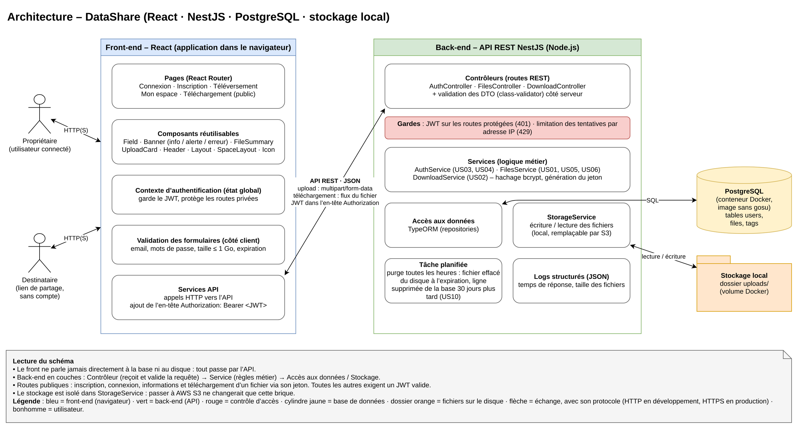
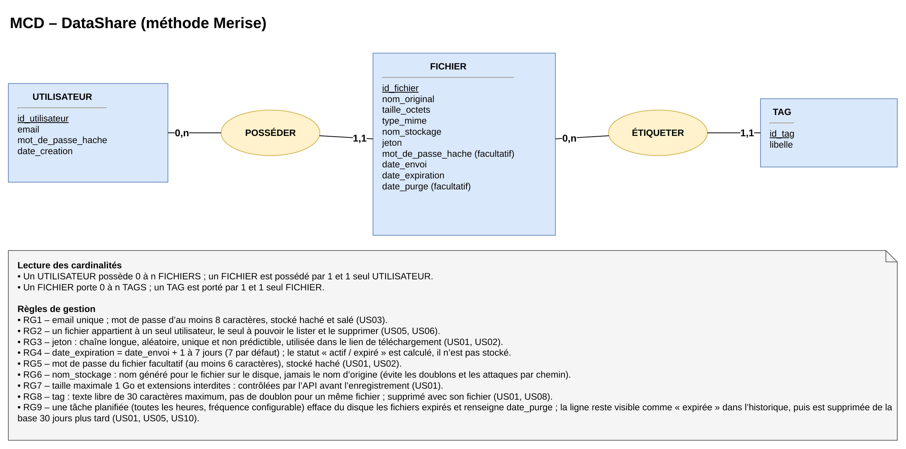

# DataShare – Documentation technique

**Prototype (MVP) de plateforme de transfert sécurisé de fichiers** pour les freelances et les petites entreprises : un utilisateur connecté dépose un fichier et obtient un lien de téléchargement temporaire, éventuellement protégé par un mot de passe.

Auteur : Yohan Bouchet · Projet 3 du Master Expert DevOps (OpenClassrooms) · Octobre 2026

Dépôt : https://github.com/yohanbouchet/datashare

Fonctionnalités livrées : US01 à US06 (MVP), et US08 (tags), US09 (mot de passe de fichier), US10 (purge automatique) parmi les fonctionnalités facultatives.

---

## 1. Architecture de l'application



| Brique | Rôle | Échanges |
|---|---|---|
| Front-end React (navigateur) | Écrans des maquettes, validation des formulaires, session (JWT) | Appels à l'API en HTTP (HTTPS en production), JSON ; envoi de fichier en `multipart/form-data` |
| API REST NestJS | Contrôleurs (routes, validation), gardes (JWT, limitation des tentatives), services (règles métier), accès aux données | SQL vers PostgreSQL ; lecture et écriture en flux sur le disque |
| PostgreSQL 18 (Docker) | Comptes, fichiers, tags | Accessible uniquement depuis la machine (`127.0.0.1`) |
| Stockage local | Fichiers déposés, sous un nom aléatoire | Uniquement par `StorageService` (remplaçable par AWS S3) |
| Tâche planifiée | Purge des fichiers expirés, toutes les heures | Disque puis base |

**Principes** : le front ne parle jamais directement à la base ni au disque ; le back-end est organisé en couches (contrôleur → service → accès aux données / stockage) ; seules l'inscription, la connexion et les routes de téléchargement par lien sont publiques.

## 2. Choix technologiques justifiés

Chaque choix part d'un **besoin** du projet, puis est fait dans la liste imposée par l'énoncé (front, back, base de données, stockage).

### Stack principale

| Besoin | Élément | Technologie choisie | Alternatives | Justification |
|---|---|---|---|---|
| Avancer vite, avec peu d'erreurs, sur le front et le back | Langage | TypeScript (back et front) | Java, C#, PHP | Un seul langage de bout en bout : mêmes types et mêmes outils ; le typage strict détecte les erreurs à la compilation |
| Recevoir des fichiers de 1 Go sans saturer le serveur | Back-end | NestJS 12 sur Node.js 24 LTS | Spring Boot, .NET Core, Symfony | Organisation en modules, contrôleurs et services imposée par le framework ; validation, injection de dépendances et JWT intégrés ; Node.js traite les fichiers en flux, adapté à 1 Go |
| Reproduire les maquettes, mêmes éléments sur chaque écran | Front-end | React 19 + Vite, React Router | Angular, Vue | Bibliothèque la plus répandue ; légère (bon budget de performance) ; composants réutilisables adaptés à la planche de composants Figma |
| Relier comptes, fichiers et tags sans incohérence | Base de données | PostgreSQL 18 (SQL) | MongoDB (NoSQL) | Données relationnelles (un utilisateur possède des fichiers, un fichier porte des tags) ; intégrité garantie par la base (clés étrangères, unicité) |
| Faire évoluer les tables sans casser les données | Accès aux données | TypeORM + migrations versionnées | Prisma, SQL manuel | Intégration documentée par NestJS ; chaque changement de structure est tracé dans Git et réversible |
| Un prototype en 4 semaines, sans coût, évolutif | Stockage des fichiers | Disque local | AWS S3 | Simple et sans coût pour un prototype ; isolé dans un service pour migrer vers S3 sans toucher au reste |

### Sécurité, services et outils

| Besoin | Élément | Technologie choisie | Alternatives | Justification |
|---|---|---|---|---|
| Savoir qui est connecté, sans session à conserver sur le serveur | Authentification | JWT (`@nestjs/jwt`), durée 1 h | Sessions serveur, OAuth2 | Demandé par les spécifications ; sans état côté serveur |
| Ne jamais pouvoir lire un mot de passe, même en cas de fuite | Mots de passe | bcrypt, coût 12 | argon2 | Algorithme éprouvé, sel intégré, volontairement lent contre la force brute |
| Refuser toute donnée invalide ou inattendue | Validation des entrées | class-validator, `ValidationPipe` global | Validation manuelle | Règles déclarées une fois ; champs inattendus refusés ; messages en français |
| Se protéger des attaques web courantes et de la force brute | Protection HTTP | helmet ; `@nestjs/throttler` | Configuration manuelle | En-têtes de sécurité ; limitation des tentatives par adresse IP |
| Un contrat d'interface toujours à jour | Documentation d'API | OpenAPI 3 (`@nestjs/swagger`) | Rédaction manuelle | Générée à partir du code, donc toujours à jour |
| La même base sur toutes les machines, en une commande | Hébergement | Docker Compose (PostgreSQL), image construite sans root | Installation locale | Même base sur toutes les machines ; démarrage en une commande |
| Vérifier chaque niveau : pièce, API, navigateur, performance | Tests | Vitest, supertest, Cypress, k6, Lighthouse | Jest, Playwright, JMeter | Outils par défaut de NestJS et Vite ; un outil par niveau de test |
| Un code homogène et un historique lisible | Qualité | Oxlint, Prettier, *conventional commits* | ESLint | Installés par les générateurs ; historique lisible par type de changement |
| Détecter les failles des dépendances et des images | Sécurité de la chaîne | npm audit, trivy, hadolint | Snyk | Gratuits, lancés en une commande (`scripts/scan-security.sh`) |
| Versionner le code et installer à l'identique | Outils | Git + GitHub, npm, VS Code | GitLab, pnpm | Demandés ou fournis avec Node.js ; versions verrouillées par `package-lock.json` |
| Automatiser les tests et les contrôles | CI/CD | Non mise en place (MVP) | GitHub Actions | Évolution prévue : tests et contrôles de sécurité à chaque envoi de code |

Détail complet : `docs/conception/choix-techniques.md`.

## 3. Modèle de données



Tables créées par les migrations TypeORM : `users` (email unique, empreinte du mot de passe), `files` (nom d'origine, taille, type, nom de stockage unique, jeton unique, empreinte facultative, dates d'envoi, d'expiration et de purge, propriétaire) et `tags` (libellé unique par fichier).
Les clés étrangères sont en `ON DELETE CASCADE` ; un index sur la date d'expiration accélère la purge. Le statut « actif / expiré » est calculé, jamais stocké.

## 4. Documentation d'API

| Méthode | Route | JWT | US | Rôle |
|---|---|---|---|---|
| POST | `/api/auth/register` | Non | US03 | Créer un compte |
| POST | `/api/auth/login` | Non | US04 | Se connecter (renvoie le JWT) |
| GET | `/api/auth/me` | Oui | US04 | Utilisateur connecté |
| POST | `/api/files` | Oui | US01 | Envoyer un fichier (`multipart/form-data`) |
| GET | `/api/files?status=active` | Oui | US05 | Historique (`active`, `expired`, `all`) |
| DELETE | `/api/files/:id` | Oui | US06 | Supprimer un fichier |
| GET | `/api/download/:token` | Non | US02 | Informations avant téléchargement |
| POST | `/api/download/:token/verify` | Non | US02 | Vérifier le mot de passe du fichier |
| POST | `/api/download/:token` | Non | US02 | Télécharger le fichier (flux) |

Toutes les réponses sont en JSON (sauf le fichier téléchargé), avec un format d'erreur unique : `{ "statusCode": 409, "message": "Cet email est déjà utilisé", "error": "Conflict" }`.

**Où se trouve la spécification** :
- le contrat d'interface détaillé (exemples de requêtes et de réponses, codes HTTP) : `docs/conception/contrat-interface.md` ;
- la spécification **OpenAPI**, générée à partir du code : page `/api/docs` de l'API (essai des routes dans le navigateur) et format JSON sur `/api/docs-json`, en développement (`API_DOCS=true`).

## 5. Sécurité et gestion des accès

| Aspect | Mise en œuvre |
|---|---|
| Authentification | JWT signé (clé secrète dans `.env`), valable 1 h, envoyé dans l'en-tête `Authorization` ; conservé dans le `sessionStorage` du navigateur (effacé à la fermeture de l'onglet) |
| Gestion des accès | Pas de rôles dans le MVP : chaque utilisateur n'accède qu'à ses propres fichiers (filtre par propriétaire dans chaque requête ; le fichier d'un autre répond 404, sans révéler son existence). Le destinataire n'a besoin que du lien |
| Mots de passe | Hachés avec bcrypt (coût 12), jamais renvoyés ; mêmes règles pour le mot de passe facultatif d'un fichier |
| Validation des entrées | Côté client (confort) et côté serveur (règle) ; champs inattendus refusés ; requêtes SQL paramétrées par TypeORM (pas d'injection) |
| Liens de partage | Jeton aléatoire de 256 bits, impossible à deviner ; masqué dans les journaux ; liens exclus des moteurs de recherche (`robots.txt`) |
| Fichiers | 1 Go maximum, contrôlé à 3 niveaux (navigateur, taille annoncée, octets réellement reçus → 413) ; extensions exécutables refusées avant écriture ; nom de stockage aléatoire (pas de traversée de chemin) ; téléchargement forcé (`attachment`, `nosniff`) |
| Anti-force brute | 5 essais par minute et par adresse IP pour l'inscription, la connexion et le mot de passe d'un fichier (429) |
| HTTPS | En production, sur le serveur web ; l'en-tête HSTS est déjà envoyé par helmet |
| Secrets et infrastructure | Secrets dans `.env` (hors Git), générés aléatoirement par le script d'installation ; base accessible seulement en local ; conteneur PostgreSQL sans root |

Correspondance avec l'**OWASP Top 10:2025**, scans et décisions : `docs/qualite/SECURITY.md`.

## 6. Qualité, tests et maintenance

| Fichier | Contenu | Résultats clés |
|---|---|---|
| **TESTING.md** | Plan de tests des fonctionnalités critiques (upload, téléchargement, authentification…), critères d'acceptation, commandes, anomalies détectées et corrigées | 77 tests unitaires et 27 tests de bout en bout de l'API, 42 tests unitaires du front, 3 scénarios Cypress dans un vrai navigateur ; couverture 88,7 % (back) et 85 % (front) pour un seuil de 70 % ; 22 anomalies consignées et corrigées |
| **SECURITY.md** | Mesures de sécurité, correspondance OWASP, scans `npm audit`, `trivy` et `hadolint` avec analyse et décisions | 0 faille haute ou critique ; outil inutilisé retiré ; 25 failles de l'image PostgreSQL officielle supprimées par une image maison |
| **PERF.md** | Test k6 sur l'envoi et le téléchargement, budget front (Lighthouse, poids du code), logs structurés et métriques | Envoi de 10 Mo en 100 ms et lecture d'un lien en 7 ms (95e centile) ; mémoire stable (traitement en flux) ; Lighthouse : performance 99-100, accessibilité 100 après correction des contrastes ; journal JSON par requête |
| **MAINTENANCE.md** | Cycle de vie des technologies (endoflife.date), procédure de mise à jour mensuelle, contrôle de sécurité hebdomadaire, sauvegarde, purge, évolutions | Node.js 24 LTS jusqu'en avril 2028 (migration vers 26 prévue), PostgreSQL 18 jusqu'en 2030 ; sauvegarde et restauration testées |

Captures des rapports (tests, couverture, Cypress, k6, Lighthouse, journaux) : `docs/rapports/`.
Revue du code écrit par l'IA : `docs/qualite/REVUE-IA-US01.md`.

## 7. Processus d'installation et d'exécution

**Prérequis** : Node.js 24 LTS (avec npm), Docker Engine et Docker Compose v2, Git, `openssl`.

**Installation automatique** (dépôt cloné) : `scripts/deploy.sh` vérifie les prérequis, crée les fichiers `.env` avec un mot de passe de base et une clé JWT aléatoires, installe les dépendances, construit et démarre PostgreSQL, puis applique les migrations.

**Lancement** :
```bash
cd backend && npm run start:dev      # API : http://localhost:3000/api
cd frontend && npm run dev           # site : http://localhost:5173
```

**Variables d'environnement** :

| Fichier | Variables principales |
|---|---|
| `.env` (racine, lu par Docker Compose et l'API) | `POSTGRES_HOST`, `POSTGRES_PORT`, `POSTGRES_DB`, `POSTGRES_USER`, `POSTGRES_PASSWORD`, `JWT_SECRET`, `JWT_EXPIRES_IN`, `FRONTEND_URL` (CORS), `UPLOAD_DIR`, `FORBIDDEN_EXTENSIONS`, `PURGE_INTERVAL_MINUTES`, `HISTORY_RETENTION_DAYS`, `API_DOCS` |
| `frontend/.env` (lu par Vite) | `VITE_API_URL` |

Les modèles `.env.example` sont publiés ; les fichiers `.env` restent hors de Git. Détails, commandes de test et de maintenance : `README.md`. Guide d'utilisation avec captures : `docs/guide-utilisateur.md`.

## 8. Utilisation de l'IA dans le développement

**Posture.** J'ai combiné deux postures. Pour l'US01, j'ai assigné la tâche à l'IA comme à un développeur junior, puis j'ai relu et fait corriger son travail. Pour le reste du projet, j'ai travaillé en binôme avec elle : elle m'expliquait le code pas à pas et je l'écrivais.

**Tâches confiées.** J'ai confié au copilote IA Claude Code (Anthropic), utilisé dans VS Code, le développement de l'US01 (téléversement d'un fichier), côté back et côté front. Son code est identifié dans l'historique Git par les commits `feat(ai)`, `test(ai)` et `refactor(ai)`.
En dehors de l'US01, j'ai écrit le code des fonctionnalités moi-même, guidé pas à pas par l'IA, qui m'expliquait chaque ligne et relisait mon travail. L'IA a aussi rédigé les tests automatisés, les scripts de déploiement et de contrôle de sécurité, ainsi qu'une partie de la documentation et des commentaires ; je les ai relus et validés. Ces contributions sont, elles aussi, identifiées par le suffixe `(ai)` dans l'historique Git.

**Supervision et corrections.** Mon rôle a été de fixer les règles à respecter (celles de l'énoncé), de relire chaque fichier pièce par pièce, de poser des questions jusqu'à pouvoir expliquer chaque choix, de vérifier le fonctionnement par les tests et par des essais manuels, et de décider des corrections.
Exemples : code renommé en anglais, commentaires rendus lisibles, un seul message d'erreur par champ, en français, nom de fichier accentué correctement restitué, contrastes corrigés pour l'accessibilité. Le détail, daté et relié aux commits, figure dans le rapport de revue `docs/qualite/REVUE-IA-US01.md`.

**Apports et limites.**

- **Apports** : un gain de temps important sur le code répétitif, les tests et la documentation ; des explications adaptées à mon niveau, qui m'ont permis de comprendre les notions de développement ; des propositions de sécurité auxquelles je n'aurais pas pensé seul.
- **Limites rencontrées** : l'IA a parfois proposé plus que nécessaire, par exemple une pile Docker complète avec Nginx que j'ai finalement retirée pour rester dans le périmètre de l'énoncé ; elle a commis des erreurs, comme un besoin de l'énoncé jugé à tort facultatif (les logs structurés) ou une modification de commentaires qui coupait des phrases, que j'ai fait corriger ; enfin, le volume de code produit demande un effort réel pour tout comprendre et pouvoir l'expliquer.
