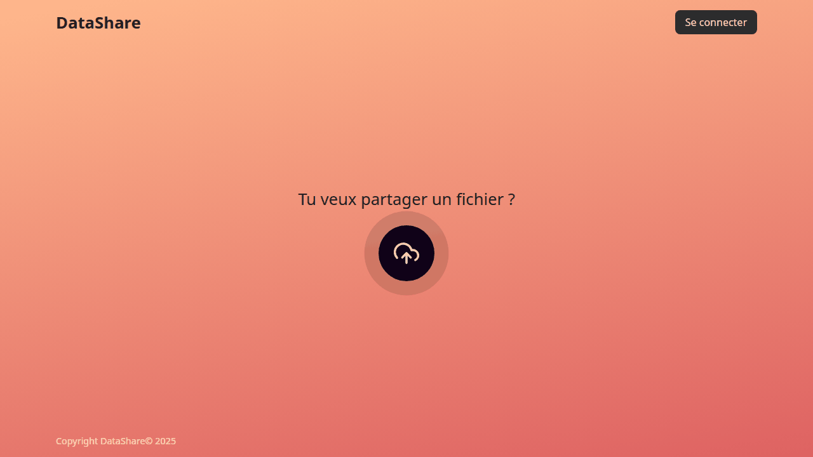
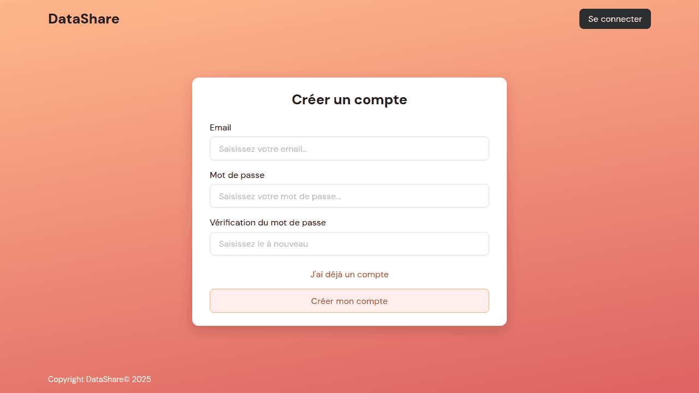
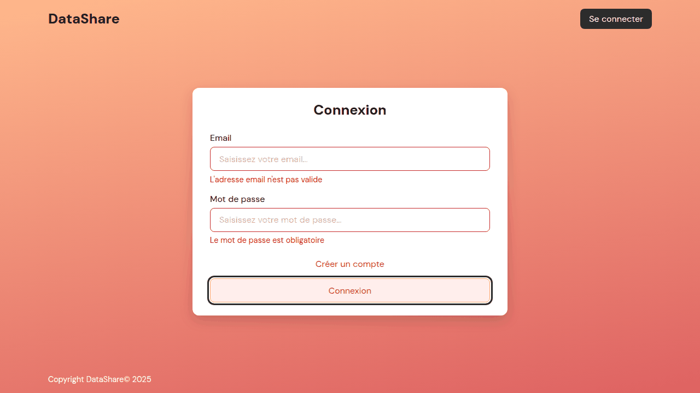
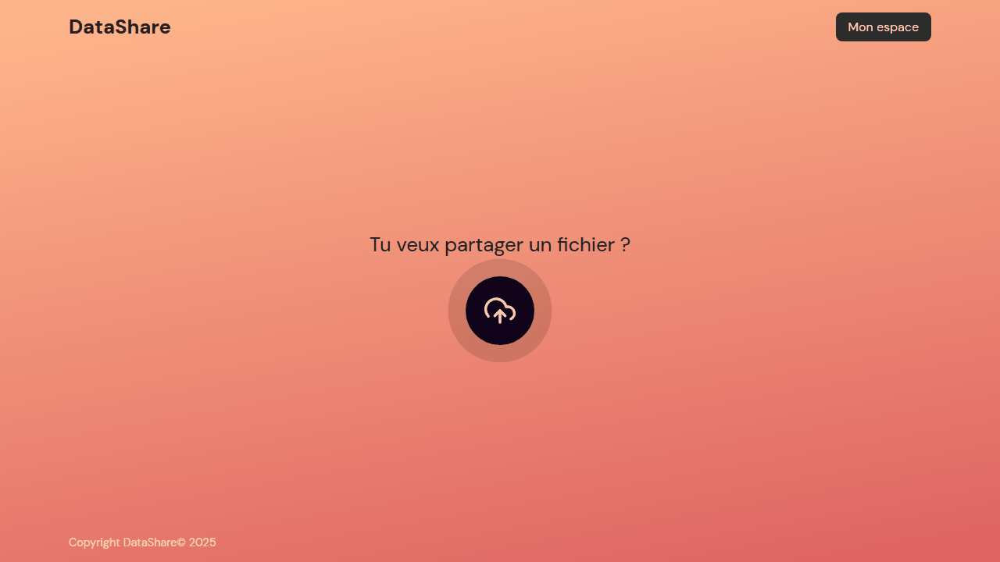
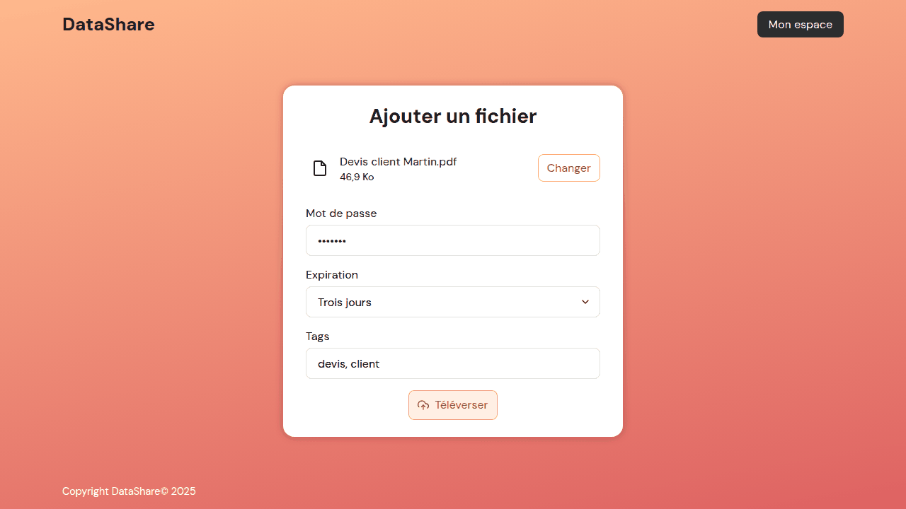
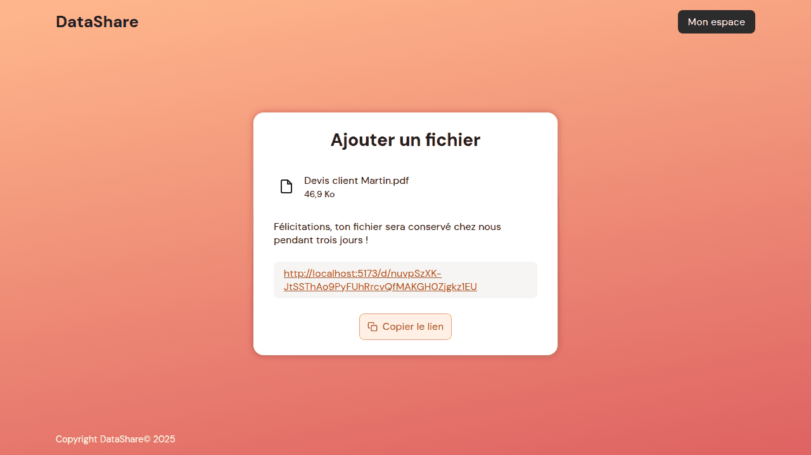
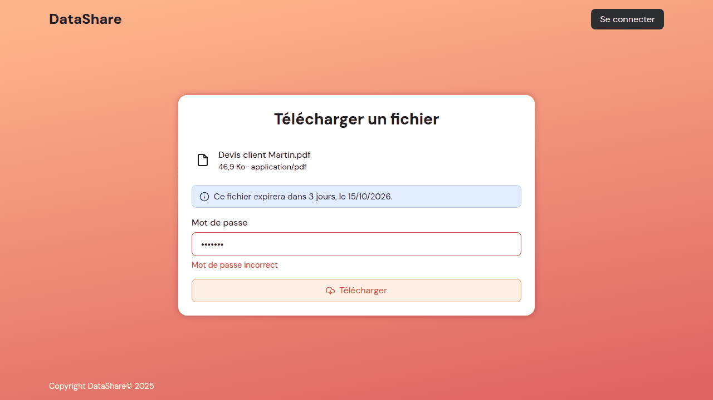
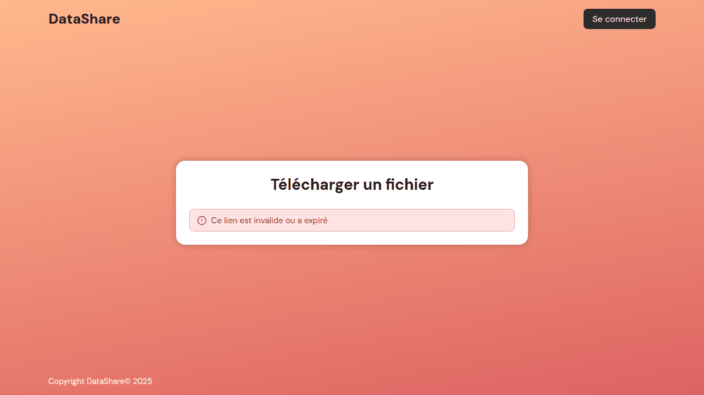
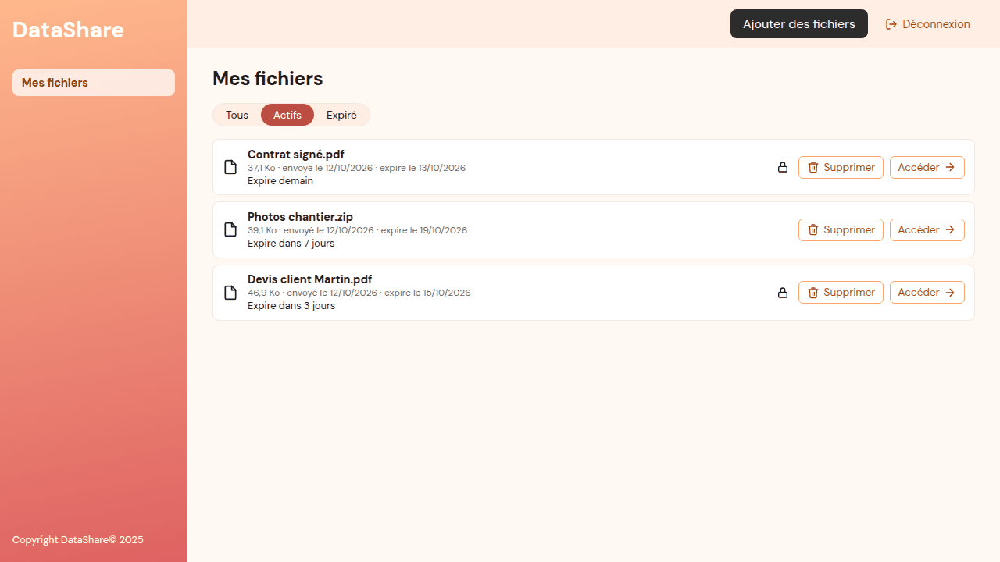
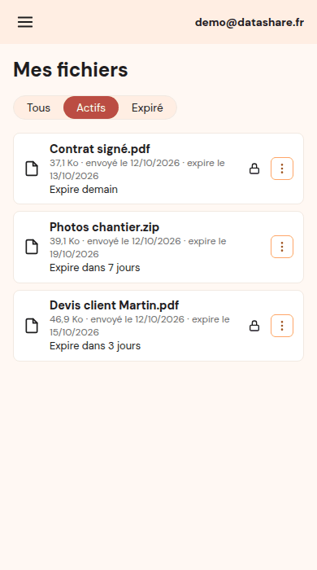

# Guide utilisateur de DataShare

DataShare vous permet d'envoyer un fichier et d'obtenir un **lien de téléchargement temporaire** à transmettre à votre client ou à votre partenaire.
Le lien peut être protégé par un **mot de passe**, et le fichier est **supprimé automatiquement** à la date d'expiration que vous avez choisie.

Le destinataire n'a **pas besoin de compte** : il lui suffit du lien (et du mot de passe, si vous en avez mis un).

---

## 1. Créer un compte

Depuis l'accueil, cliquez sur **Se connecter**, puis sur **Créer un compte**.

- Saisissez votre adresse email et un mot de passe d'**au moins 8 caractères**, deux fois.
- Une fois le compte créé, vous arrivez sur la page de connexion.

## 2. Se connecter

Saisissez votre email et votre mot de passe, puis cliquez sur **Connexion**.
Un champ mal rempli est encadré en rouge, avec le message qui explique quoi corriger ; le message disparaît dès que vous modifiez le champ.

Votre session reste ouverte une heure, tant que l'onglet est ouvert. Ensuite, DataShare vous redemande de vous connecter.

## 3. Envoyer un fichier

Une fois connecté, cliquez sur le **bouton rond** de l'accueil et choisissez un fichier sur votre ordinateur.

La carte « Ajouter un fichier » s'affiche :

| Champ | À quoi il sert |
|---|---|
| **Changer** | Choisir un autre fichier |
| **Mot de passe** (facultatif) | Protège le téléchargement ; au moins 6 caractères. Transmettez-le à votre destinataire par un autre moyen que le lien (SMS, téléphone) |
| **Expiration** | Durée de conservation : de une journée à une semaine (une semaine par défaut) |
| **Tags** (facultatif) | Mots-clés séparés par des virgules (ex. `devis, client`), pour vous y retrouver |

Cliquez sur **Téléverser** : une barre indique la progression de l'envoi.

**Bon à savoir**
- Taille maximale : **1 Go** par fichier. Au-delà, DataShare vous prévient avant même l'envoi.
- Les programmes (`.exe`, `.msi`, `.bat`, `.sh`, `.js`…) sont refusés, pour la sécurité de vos destinataires.

## 4. Partager le lien

À la fin de l'envoi, DataShare affiche le **lien de partage**.

Cliquez sur **Copier le lien**, puis collez-le dans votre email ou votre message.
Ce lien est unique et impossible à deviner : seules les personnes à qui vous l'envoyez peuvent l'utiliser.

## 5. Ce que voit votre destinataire

En ouvrant le lien, votre destinataire voit le **nom**, la **taille** et le **type** du fichier, ainsi que sa **date d'expiration**.
Si le fichier est protégé, il saisit le mot de passe puis clique sur **Télécharger** : le fichier s'enregistre sur son ordinateur.

Si le lien est faux, ou si le fichier a été supprimé ou a expiré, un message l'indique :

## 6. Gérer vos fichiers : « Mon espace »

Cliquez sur **Mon espace** en haut de la page.

- Chaque ligne indique le nom, la taille, la date d'envoi, la date d'expiration et le temps restant ; un **cadenas** signale un fichier protégé par mot de passe.
- Le filtre **Actifs** (par défaut) montre les fichiers encore disponibles ; **Expiré** montre ceux qui ont expiré ; **Tous** montre l'ensemble.
- **Accéder** ouvre la page de téléchargement, telle que la voit votre destinataire.
- **Supprimer** efface définitivement le fichier, après confirmation : le lien ne fonctionne plus.

Sur téléphone, le menu ☰ donne accès aux pages, et le bouton ⋮ de chaque ligne aux actions **Supprimer** et **Accéder**.

**Expiration** : à la date choisie, le fichier est effacé de nos serveurs. Il reste visible 30 jours dans le filtre **Expiré** (sans pouvoir être téléchargé), puis disparaît de votre historique.

## 7. Messages et solutions

| Message | Signification | Que faire |
|---|---|---|
| « Cet email est déjà utilisé » | Un compte existe déjà avec cet email | Connectez-vous |
| « Email ou mot de passe incorrect » | Identifiants faux | Vérifiez votre saisie (majuscules comprises) |
| « Trop de tentatives. Réessaie dans une minute. » | Protection contre les essais répétés de mots de passe | Patientez une minute |
| « La taille des fichiers est limitée à 1 Go » | Fichier trop volumineux | Compressez-le ou découpez-le |
| « Ce type de fichier n'est pas autorisé » | Programme ou script refusé | Envoyez un autre format (ex. une archive `.zip` d'un document) |
| « Mot de passe incorrect » | Mauvais mot de passe du fichier | Demandez le bon mot de passe à l'expéditeur |
| « Ce lien est invalide ou a expiré » | Lien faux ou fichier supprimé | Demandez un nouveau lien à l'expéditeur |
| « Ce fichier n'est plus disponible en téléchargement car il a expiré. » | Date d'expiration dépassée | Demandez à l'expéditeur de renvoyer le fichier |
| « Impossible de joindre le serveur. Réessaie dans quelques instants. » | Connexion internet ou serveur indisponible | Réessayez plus tard |
| Retour à la page de connexion | Session expirée (au bout d'une heure) | Reconnectez-vous |

## 8. Confidentialité

- Votre mot de passe et celui de vos fichiers ne sont **jamais stockés en clair**.
- Les liens de partage ne sont pas indexés par les moteurs de recherche.
- Les fichiers sont effacés à leur date d'expiration, et l'historique au bout de 30 jours.
